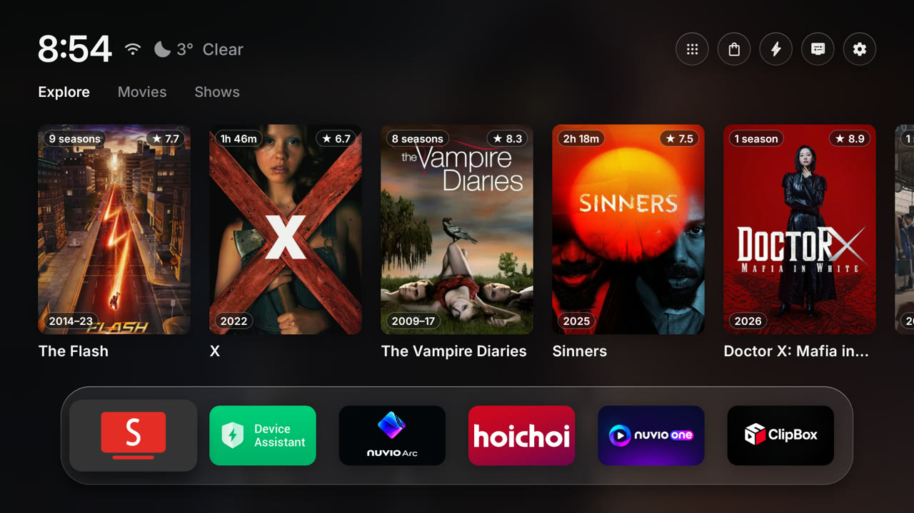
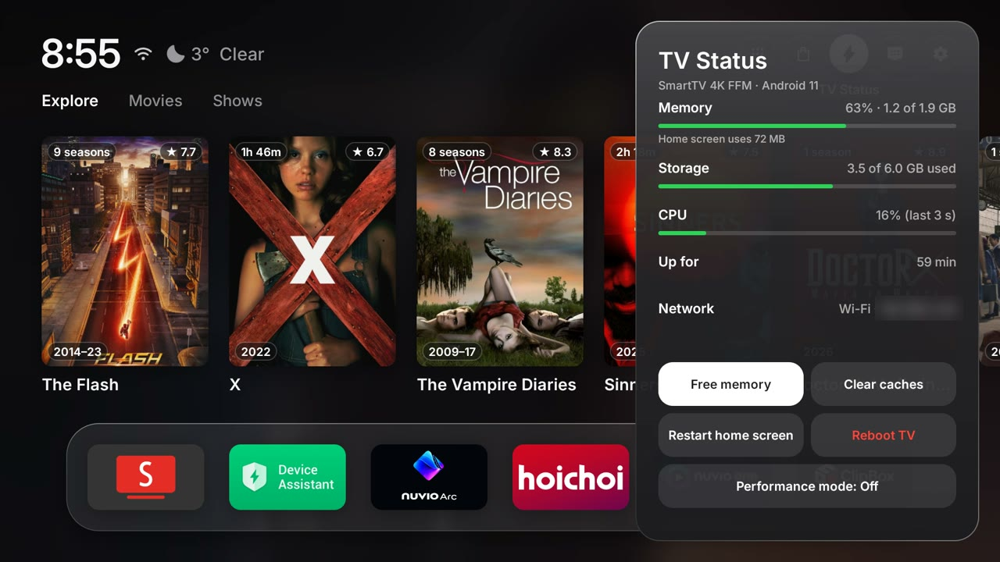
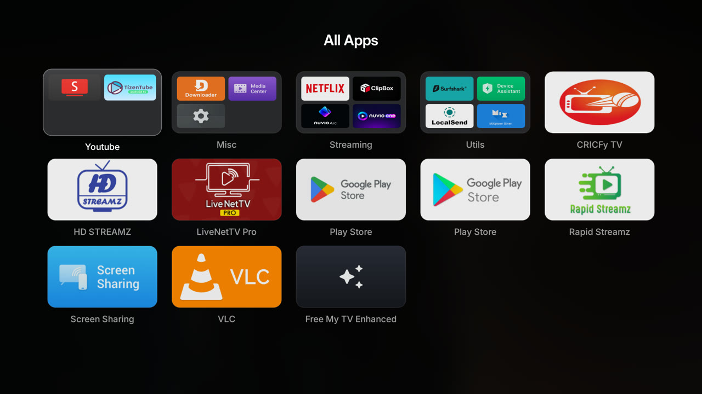
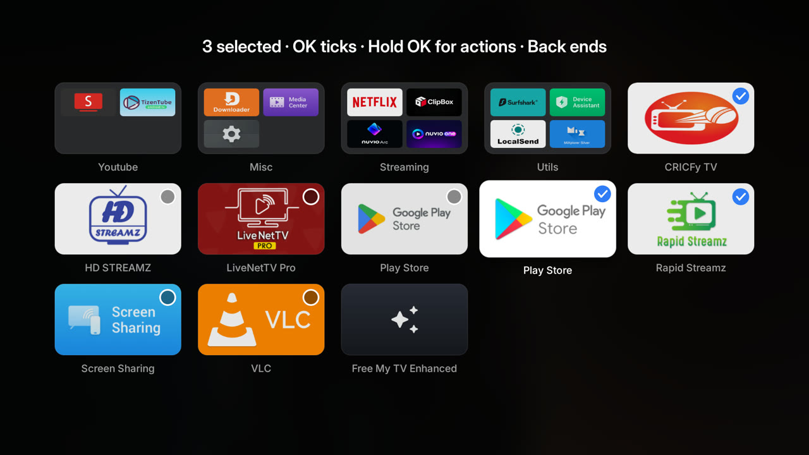
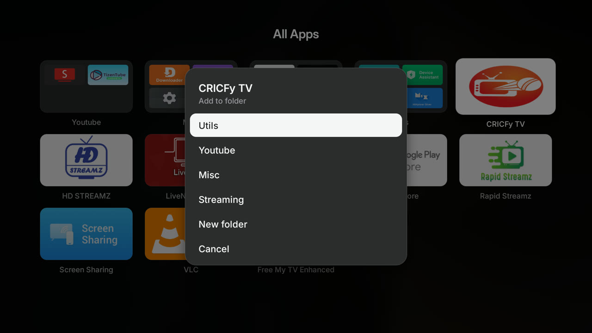
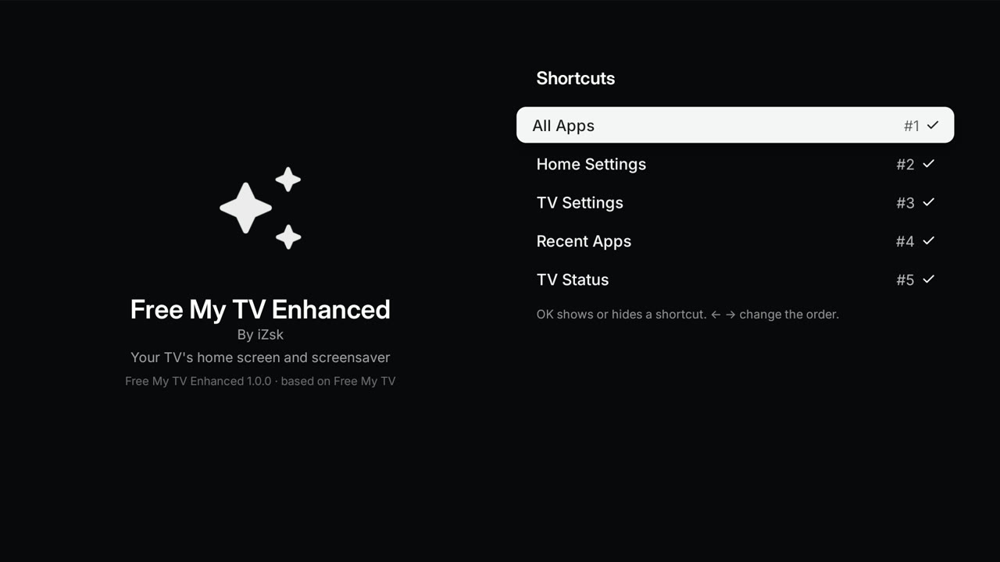
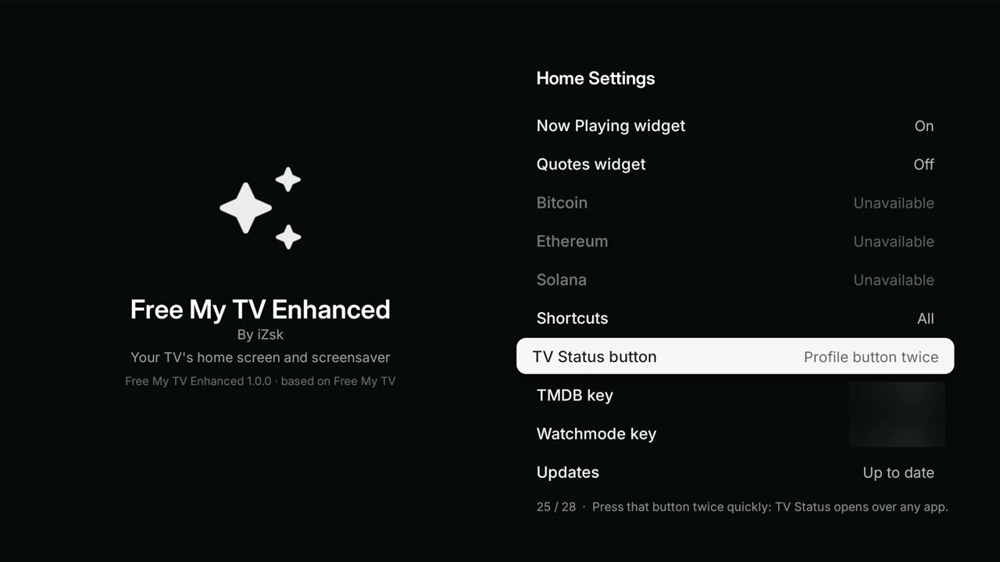

# Free My TV Enhanced

A fork of [Free My TV](https://github.com/simbasjungles/free-my-tv) by simbasjungles, with extra home screen features
for Google TV and Android TV, by iZsk. Everything the original does still works the same way. The package stays
`io.freemytv`, so it installs over a Free My TV build signed with the same key. Only the Google TV / Android TV app
has the additions (the LG and Samsung web app is the original's).

**Version:** Enhanced has its own numbers, starting at **1.0.0**. Settings shows *Free My TV Enhanced 1.0.5 · based
on Free My TV*.

## What's new compared with Free My TV

| Area | Free My TV | Enhanced adds |
|---|---|---|
| **Picks (cards at the top)** | Trending titles on your services | Up to 7 cards per tab; a *Highlight* focus (the card pops up, no ring; Picks → Card focus); badges on each card: runtime or seasons, TMDB rating, and the year (a show's span, such as *2022–26*); the streaming service's logo under the length, from TMDB's own data on who carries the title (so a Continue Watching card played by Nuvio shows Disney+ or Prime, never Nuvio, and a service you switched off or don't have still shows; the TV's app icon, Nuvio's for a Nuvio card, only when TMDB has no logo) and the genre at the bottom right. Under the focused card, *Because you loved …* is a thumb and the loved title; a title too long for the card scrolls, rests, and scrolls again while the card has focus |
| **Suggestions** | Trending only | *Your taste*: TMDB recommendations from the genres and titles you like. Hold OK on a card (a pick or a genre row's) for *Love it* / *Not for me*. *Love it* keeps the card where it is; the *Because you loved …* picks come with the next refresh (every 6 hours, or when the time of day changes). *Not for me* takes the card off at once |
| **Open picks with** | The service's app | Any app that opens `nuvio://tmdb/...` links (Nuvio and its forks). With two or more, OK asks which one. A *Continue Watching* card asks the same way: its own app first, then these apps. With no TMDB match for the title there is no title link: the chooser is headed *Open with (search manually)* and the other apps open at their home, so you search the title there |
| **Rows under the shelf** | – | *Continue Watching* as its own row, with the picks' badges (length, rating, year) and the app's icon on each card (on top it uses the picks' tall cards); up to three *genre rows* (popular titles of a genre on your services) |
| **Title line** | – | The time and the weather (icon colored by the conditions) next to the picks' title, laid out on the time's height: the icon and degrees on the middle line (the Wi-Fi icon's), the condition starting at the top of the digits, the day's high and low on their baseline in the unselected tabs' grey |
| **Screensaver** | A slow zoom and pan; with *Watch from the screensaver* on, OK opens the title in its app | A stronger zoom (28%) on every picture, always zooming in, with the pan corners alternating evenly; the day's high and low under the weather in the corner (the clock moves down a line to make room). With *Watch from the screensaver* on and two or more apps in *Open picks with*, OK on a Nuvio pick asks which app first (the same chooser); Back or Cancel returns to the pictures. Off, nothing changes |
| **Hisense wake** | – | The remote-button service is only restarted two minutes after the home screen opens: Hisense's firmware blocks starting a third-party service for about a minute after the TV wakes, and Android then force-stopped the app (the Play Store showed at power-on) |
| **All Apps** | Open, Move, shelf | Hold OK for a menu: Move, Add to / Remove from shelf, **Add to folder**, **Select several**, App info |
| **Folders** | – | Apple TV style folders with a 2×2 preview; rename, delete, put a folder on the shelf, move apps between folders |
| **Select several** | – | Tick apps with OK, then put them all in a folder or on the shelf at once (inside a folder: remove or move them) |
| **TV Status** | – | A glass panel over the home screen *or over any app*: memory, storage, CPU, uptime, network; **Free memory**, **Clear caches**, **Restart home screen**, **Reboot TV**, and the **Performance mode** switch |
| **Opening TV Status** | – | Drawer → Shortcuts, a top button, a remote button (Remote Buttons → *TV Status*), or **two quick presses** of a remote button you choose (Home Settings → *TV Status button*) |
| **Drawer shortcuts** | Fixed list | Home Settings → *Shortcuts*: show or hide each one and change their order |
| **Top buttons** | Settings, Recent Apps… | Also All Apps, TV Settings and TV Status |
| **Performance mode** | – | Flat panels instead of glass and no blurred shadows, for slower TVs (TV Status, or Picks → last row) |
| **Several TVs** | – | Copy one TV's on-screen settings, folders and remote buttons to others: `./sync-settings.sh FROM_IP TO_IP` |
| **Measuring** | – | `./perf-check.sh <IP>`: the home screen's frame times and memory, for before/after comparisons |
| **Updates** | Checks Free My TV's releases | Checks Enhanced's releases, and says when a newer Free My TV is out |



| TV Status | Folders | Select several |
|---|---|---|
|  |  |  |
| **Add to folder** | **Shortcuts** | **Settings** |
|  |  |  |

Every change to an original file carries a `[custom]` comment, so merging the original's updates stays easy.

## Setting it up

You need a computer (macOS, Linux, or Windows with Git Bash), the TV's IP address, and about 20 minutes.

1. **Tools:** a JDK 17+, the Android SDK command-line tools (build-tools 34, platform android-34) and adb.
   On macOS: `brew install --cask temurin android-commandlinetools android-platform-tools`, then
   `sdkmanager "build-tools;34.0.0" "platforms;android-34"`.
2. **Get the code:** `git clone https://github.com/sk-izsk/free-my-tv-enhanced.git && cd free-my-tv-enhanced`
3. **Settings:** run `./build.sh` once. It copies [`config.example.properties`](config.example.properties) to
   `config.properties`. Fill in your city (`latitude`, `longitude`, `city`), `tmdb_region` (your country) and,
   optionally, the keys below. `config.properties` is yours: never commit it.
4. **Build:** `./build.sh` again. It must end with `Built FreeMyTV.apk`. The first build makes `freemytv.keystore`;
   keep it, because every update must be signed with the same key.
5. **On the TV:** turn on Developer options (Settings → System → About → press *Android TV OS build* 7 times), then
   *USB debugging*.
6. **Install:** `adb connect <TV IP>:5555` (accept *Allow USB debugging?* on the TV and tick *Always allow*), then
   `adb install -r FreeMyTV.apk`. If it hangs, Google Play Protect is asking on the TV: *More details* → *Install
   anyway*.
7. **Switch:** on the TV, open *Free My TV Enhanced* → *Home Screen* → *Free My TV Enhanced*. *Original* brings
   the TV's own home screen back at any time.

Free My TV's [own guide](https://github.com/simbasjungles/free-my-tv#readme) has more on each TV brand, the screensaver
and the optional servers (Plex, Immich, Home Assistant, Trakt).

## The keys, and what works without them

Both keys are free and optional. They go in `config.properties`, or are typed on the TV (Home Settings → *TMDB key*
or *Watchmode key*, with a QR code for your phone).

| Without… | What you lose | What still works |
|---|---|---|
| **TMDB key** (themoviedb.org → Settings → API) | The picks at the top, their badges, *Your taste*, the genre rows, *Open picks with*, and the picks' pictures on the screensaver | Everything else: the shelf, All Apps, folders, Select several, TV Status, Performance mode, the Continue Watching row (it comes from the TV), the weather, the clock, remote buttons, the screensaver with your own photos, settings sync |
| **Watchmode key** (watchmode.com) | A pick opens its streaming app's home instead of the title's own page | Everything else |

## Versions and keeping up with Free My TV

- Enhanced's version (`versionName` in `app/AndroidManifest.xml`) is its own: 1.0.0, then 1.0.1 for fixes, 1.1.0
  for new features. `versionCode` starts at 100 and goes up by one with every release. `Updates.BASED_ON` notes the
  Free My TV release last merged (never shown; it only tells when the original has a newer one).
- *Home Settings → Updates* checks this repository's releases (tag `v1.0.0` and so on), and also says when Free My TV
  has a newer release than the one merged.
- A weekly GitHub workflow (`.github/workflows/upstream-watch.yml`) fails, and GitHub emails
  the owner, when Free My TV publishes a release newer than `BASED_ON`, so its updates aren't missed.
- To bring in the original's changes:
  ```bash
  git remote add upstream https://github.com/simbasjungles/free-my-tv.git   # once
  git fetch upstream
  git merge upstream/main          # merge, never reset: keeps the [custom] changes
  ./build.sh                       # then raise the version and BASED_ON, and install
  git rm -r --ignore-unmatch docs  # the original's website isn't part of this fork
  ```
  Conflicts only happen where a `[custom]` change and an original change touch the same lines; keep both.
  Then run [*Testing Enhanced after a change or an upstream merge*](#testing-enhanced-after-a-change-or-an-upstream-merge):
  the checks, the on-TV checklist and the performance comparison. The language files conflict on every merge: re-run
  `python3 tools/translate.py --check` and fill what it lists.

## Testing Enhanced after a change or an upstream merge

Free My TV doesn't know about these features, so nothing upstream tests them. After you add a feature, and **after
every merge of Free My TV** (`git merge upstream/main`), run all of this. A merge can compile and still quietly break
one of them.

**1. Automatic** (the same checks CI runs on a pull request):
```bash
tools/check.sh                           # build, remote-button tests, translations, LG and Samsung packages
python3 tools/translate.py --check       # every language has every string
```
New or renamed on-screen text makes the second one fail. Fill the gaps with `python3 tools/translate.py --fill --prune`
(needs an Anthropic API key, and `--lang pt` and so on for the hand-translated languages), or add the strings to every
`app/assets/i18n/<lang>.json` yourself: hand translations for the languages that have them (de, es, pt, ru, th, tr), the
English text for the rest (the app already shows English for a missing key).

**2. On a TV** (install with `adb install -r FreeMyTV.apk`, then look at each line):

| Feature | Do this | Expected |
|---|---|---|
| Picks, badges | Home screen, move across the cards | Each card shows length (top left), the app's icon under it, rating (top right), year (bottom left), genre (bottom right; not on genre rows); a show's span like *2022–25*. Focused card from *Your taste*: a thumb and the loved title under it, scrolling when too long |
| Card focus | Move the focus onto a card | It pops up with a deeper shadow: no ring, no outline |
| Weather | Look at the top line | Icon colored by the conditions; the text in the time's color; the condition at the top of the time's digits and the day's high and low (*H:12°  L:5°*) on their baseline, in the grey of the unselected tabs; the drawer's weather card unchanged |
| Love it / Not for me | Hold OK on a pick (Suggestions: Your taste) | *Love it*: a toast, and the card stays in the list. *Not for me*: the card goes at once |
| Open picks with | OK on a pick | A panel: the apps from Picks → Open picks with, then Cancel |
| Continue Watching row | Down from the shelf, move across | Cards with the same three badges (where TMDB knows the title) and the app's icon under the length |
| Continue Watching on top | Home Settings → Top of the screen → Continue Watching | Tall cards, the size of the picks' cards, five across, with the poster and the same badges; the row under the shelf is hidden |
| Continue Watching Open with | OK on a card | Its own app first, then the Open picks with apps, then Cancel; a title TMDB doesn't know says *Open with (search manually)* |
| Folders, Select several | All Apps, hold OK on an app | The menu has *Add to folder* and *Select several*; folders open and rename |
| TV Status | Drawer → Shortcuts → TV Status | The panel opens; *Free memory* and *Performance mode* work |
| Home Settings | Open it | Language, Top of the screen, Picks, Continue Watching apps and the rest are all there and change values |
| Screensaver | Home Settings → Screensaver → Preview | Each picture slowly zooms in and pans; the next one fades in; in the corner the date, the weather and under it *H:12°  L:5°* in grey, then the clock |
| Screensaver chooser | Home Settings → *Watch from the screensaver* On, start the screensaver (*Preview*), press OK | The chooser opens over the picture (the Open picks with apps, then Cancel); Up/Down move, OK opens, Back closes it and the pictures go on. With the setting Off, OK just wakes the TV |
| Wake from standby (Hisense) | Standby for 4 minutes, then turn on | The home screen is in front. Not the Play Store: `adb logcat -d \| grep "start failure"` must print nothing |
| Status icons | Home Settings → Status icons On | The Wi-Fi (or Ethernet) icon shows after the time; off, no icon (it is off by default) |
| Settings survive | Install over the old build | Folders, shelf order and Home Settings are still there |

**3. Performance** (`perf-check.sh`): a feature must not make the home screen slower. It presses the same keys every run
(across the picks, the shelf and the Continue Watching row) and prints the janky-frame percentage, the 50th, 90th,
95th and 99th percentile frame times and the home process's memory:
```bash
./perf-check.sh <TV IP> after        # the build you want to judge
```
Compare it with the build before the change, on the same TV, with the TV otherwise idle, and run each twice (one run
varies by a few points):
```bash
git worktree add ../baseline dev     # the code before the change (or a release tag)
cp config.properties freemytv.keystore ../baseline/ && (cd ../baseline && ./build.sh)
adb install -r -d ../baseline/FreeMyTV.apk && ./perf-check.sh <TV IP> before     # -d allows the lower version
adb install -r FreeMyTV.apk && ./perf-check.sh <TV IP> after
git worktree remove --force ../baseline
```
"Not slower" means the janky percentage and the 90th and 99th percentile frame times are within noise of *before*
(about 3 points of janky frames), and the memory (PSS) has not grown by more than a few MB. A slow TV (the bedroom
Hisense has 1.8 GB of RAM) can be janky either way; only the difference counts. At 60 fps a frame has 16 ms.
The screensaver is not part of `perf-check.sh`: start it (*Screensaver → Preview*) and read
`adb shell dumpsys meminfo io.freemytv` (total PSS) before and after.

**Adding a feature:** mark every change to an original file with `[custom]`; add a row to *What's new* above and to
the checklist in step 2; add a line to the README's list; add its strings to every language; raise the version; and
run steps 1 to 3 before you open the pull request.

## Credits

- [Free My TV](https://github.com/simbasjungles/free-my-tv) by simbasjungles: everything this builds on.
- [Weatherglass TV](https://github.com/faizaldjoo/weatherglass-tv) by faizaldjoo: the TV Status idea (no code from
  it).
- Data from [TMDB](https://www.themoviedb.org) (this product uses the TMDB API but is not endorsed or certified by
  TMDB).
