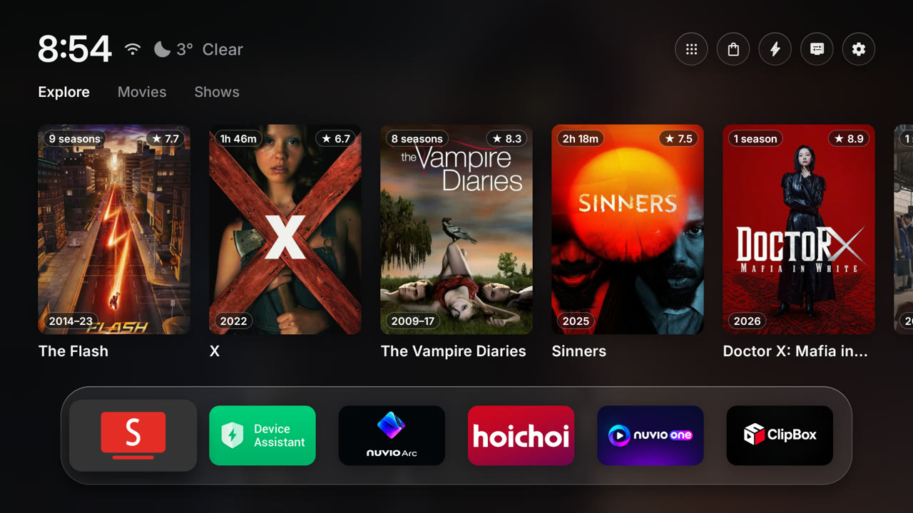
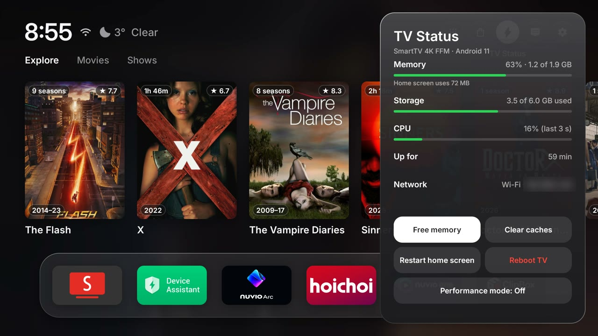
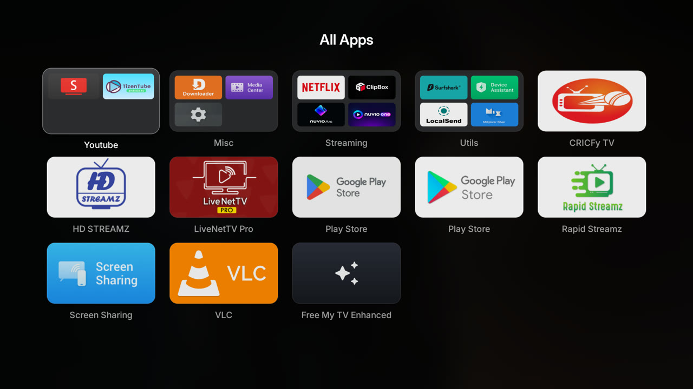
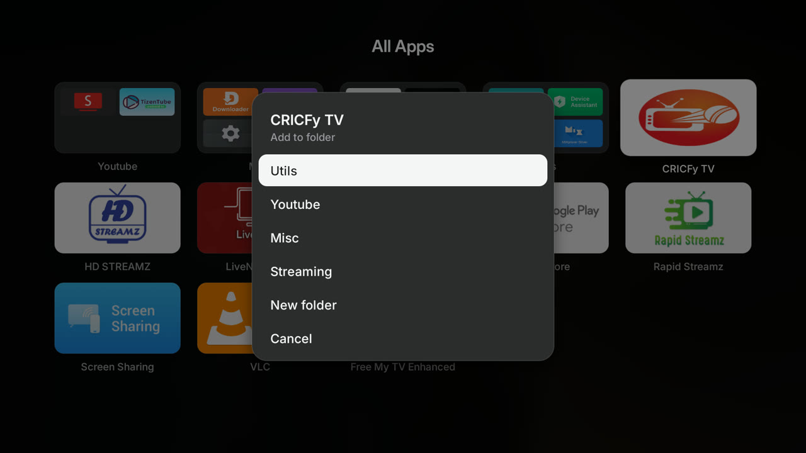
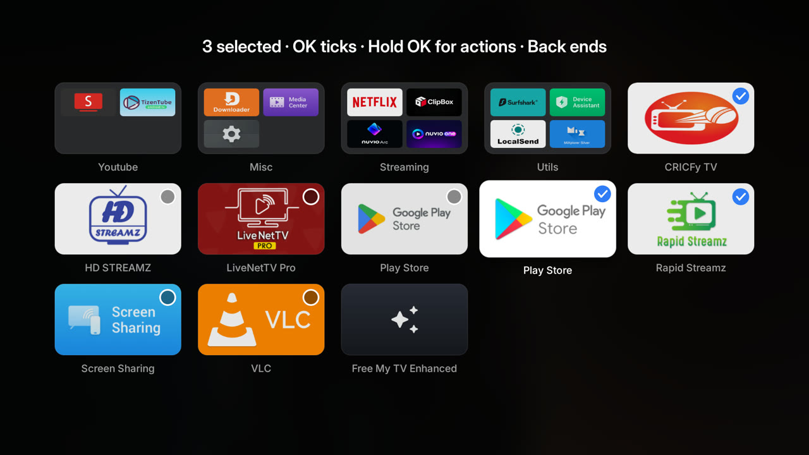
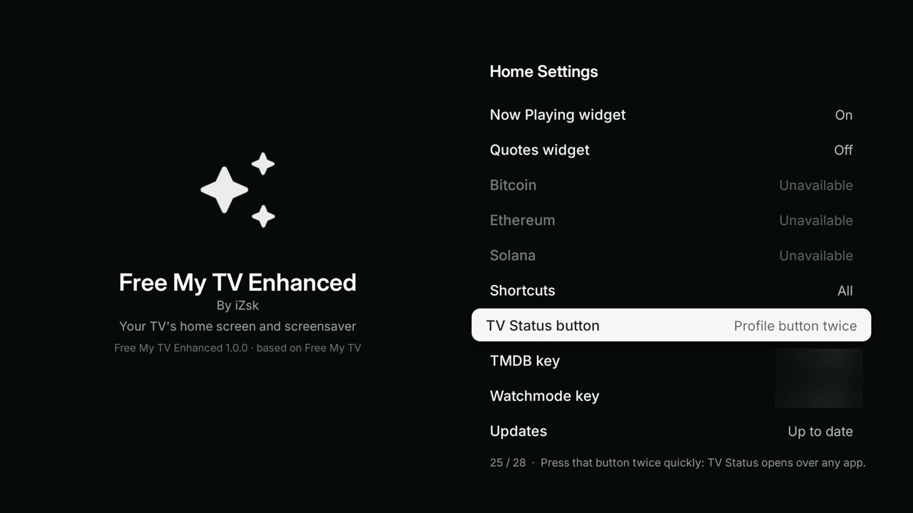
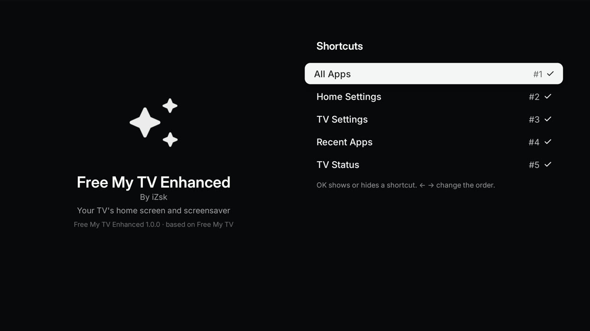
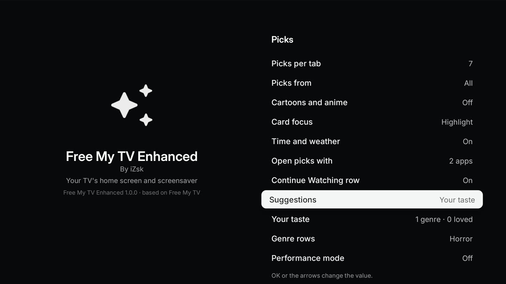

# Free My TV Enhanced

**An ad-free home screen for Google TV and Android TV, with folders, a TV Status panel you can open over any app,
and suggestions that follow your taste.**

A fork of [Free My TV](https://github.com/simbasjungles/free-my-tv) by simbasjungles, extended by iZsk. Everything
Free My TV does on Google TV and Android TV is here, plus the features below. The LG and Samsung app is Free My TV's
own: for those TVs, use [the original project](https://github.com/simbasjungles/free-my-tv#readme).

[What's new](ENHANCED.md) · [Install](#install) · [The keys](#the-keys) · [Updates](#updates) ·
[Going back](#going-back) · [Free My TV's full guide](https://github.com/simbasjungles/free-my-tv#readme)

## What you get

**From Free My TV:** no ads or sponsored rows; your streaming apps on a glass shelf; trending picks from the apps you
already have; Continue Watching; weather, a clock and a screensaver; light by day and dark by night; no root, nothing
uninstalled, and one button brings the factory home screen back.

**Added by Enhanced** (details in [ENHANCED.md](ENHANCED.md)):
- **Folders** in All Apps, Apple TV style, and **Select several** to move many apps at once
- **TV Status:** memory, storage, CPU, uptime and network, with Free memory, Clear caches, Restart home screen,
  Reboot TV and a Performance mode switch. It opens over any app with **two quick presses of a remote button you
  choose**.
- **Your taste:** suggestions from the genres and titles you like (*Love it* / *Not for me*)
- **Badges on every card:** runtime or seasons, rating, and the year (a show's span, like *2022–26*)
- **Continue Watching and genre rows** under the shelf
- **Your drawer, your way:** choose which shortcuts and top buttons show, and their order
- **Performance mode** for slower TVs
- **Several TVs:** copy one TV's settings, folders and remote buttons to another

## Screenshots

<p align="center"></p>

| | |
|---|---|
|  **TV Status** over the home screen or any app |  **Folders** in All Apps |
|  **Add to folder**: every folder, or a new one |  **Select several** apps at once |
|  **Shortcuts** and the **TV Status button** |  Choose and order the drawer's **shortcuts** |
|  **Picks**: Your taste, genre rows, Performance mode | |

## Install

### The easy way: an AI assistant

1. Install [Claude Code](https://claude.com/claude-code) or another coding assistant on your computer, and turn on
   *USB debugging* on the TV (Settings → System → About → press *Android TV OS build* 7 times, then Developer
   options → *USB debugging*).
2. Say:
   > Install Free My TV Enhanced (github.com/sk-izsk/free-my-tv-enhanced) on my TV at 192.168.1.50. I live in Lisbon.

   The assistant reads this repository's guide ([CLAUDE.md](CLAUDE.md)). It installs the tools, builds the app with
   your city, installs it on the TV and tells you what the Enhanced features are and where to find them. It asks for
   nothing secret in the chat: you paste your keys into a file yourself.

### The manual way

You need a computer (macOS, Linux, or Windows with Git Bash) and the TV's IP address.

1. **Tools:** a JDK 17+, the Android SDK command-line tools (build-tools 34, platform android-34) and adb. On macOS:
   ```bash
   brew install --cask temurin android-commandlinetools android-platform-tools
   sdkmanager "build-tools;34.0.0" "platforms;android-34"
   ```
2. **The code:**
   ```bash
   git clone https://github.com/sk-izsk/free-my-tv-enhanced.git && cd free-my-tv-enhanced
   ```
3. **Settings:** run `./build.sh` once. It copies [`config.example.properties`](config.example.properties) to
   `config.properties`. Fill in your city (`latitude`, `longitude`, `city`), your country (`tmdb_region`) and,
   optionally, [the keys](#the-keys). Never commit `config.properties`.
4. **Build:** `./build.sh` again. It must end with `Built FreeMyTV.apk`. Keep `freemytv.keystore`, which the first
   build makes: every update must be signed with it.
5. **Install:**
   ```bash
   adb connect 192.168.1.50:5555      # your TV's IP; accept "Allow USB debugging?" on the TV, tick "Always allow"
   adb install -r FreeMyTV.apk
   ```
   If it hangs, Google Play Protect is asking on the TV: *More details* → *Install anyway*.
6. **Switch:** on the TV, open *Free My TV Enhanced* → *Home Screen* → *Free My TV Enhanced*.
7. **Try the extras:** Home Settings → *TV Status button* (pick a remote button), *Shortcuts*, and *Picks* (Your
   taste, genre rows, Performance mode). In All Apps, hold OK on an app for folders.

Brand-specific notes (TCL, Sony, Xiaomi, Philips, projectors…), Plex, Immich, Home Assistant and Trakt work as in
Free My TV: see [its guide](https://github.com/simbasjungles/free-my-tv#readme) and [CLAUDE.md](CLAUDE.md).

## The keys

Both are free and optional. Put them in `config.properties`, or type them on the TV (Home Settings → *TMDB key* /
*Watchmode key*, with a QR code for your phone).

| Without… | You lose | Everything else works |
|---|---|---|
| **TMDB key** ([themoviedb.org](https://www.themoviedb.org/settings/api)) | The picks at the top, their badges, *Your taste*, the genre rows, *Open picks with*, and the picks' pictures on the screensaver | Shelf, All Apps, folders, TV Status, Performance mode, Continue Watching row, weather, clock, remote buttons, your own photos, settings sync |
| **Watchmode key** ([watchmode.com](https://api.watchmode.com)) | A pick opens its app's home instead of the title's own page | Everything |

## Updates

Enhanced has its own version numbers (1.0.0 and up), and its own releases on
[this repository](https://github.com/sk-izsk/free-my-tv-enhanced/releases).

- **On the TV:** Home Settings → *Updates* checks this repository's releases. It tells you when a new Enhanced is
  out, and also when Free My TV itself has a newer version.
- **To update:** you build it yourself, signed with your own key, so the TV can't install someone else's APK over it.
  Get the new code and build again:
  ```bash
  git pull
  ./build.sh && adb install -r FreeMyTV.apk
  ```
  Or tell your AI assistant: *"Update Free My TV Enhanced on my TV at 192.168.1.50."*
- **Following Free My TV:** this fork merges the original's updates into new Enhanced releases, so you get both.

## Going back

On the TV: *Free My TV Enhanced* → *Home Screen* → *Original*. The factory home screen, screensaver and every app
come back as they were. If the new home screen crashes three times in five minutes, it switches back by itself.
To remove it, switch to *Original* first, then uninstall it (Settings → Apps).

## Credits

- [Free My TV](https://github.com/simbasjungles/free-my-tv) by simbasjungles: everything this builds on.
- [Weatherglass TV](https://github.com/faizaldjoo/weatherglass-tv) by faizaldjoo: the TV Status idea (no code from
  it).
- Data from [TMDB](https://www.themoviedb.org) (this product uses the TMDB API but is not endorsed or certified by
  TMDB) and [Open-Meteo](https://open-meteo.com).

## License

MIT, as Free My TV: see [LICENSE](LICENSE).
